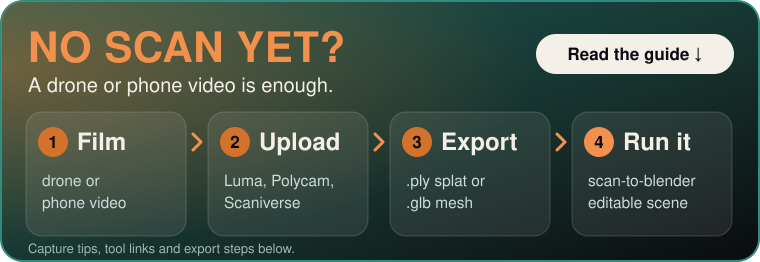
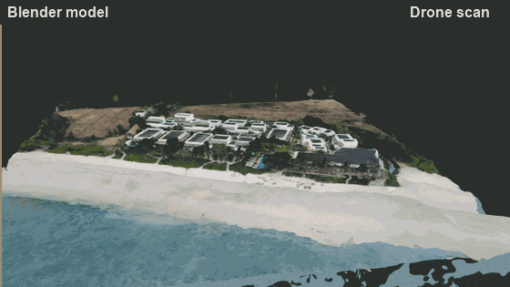
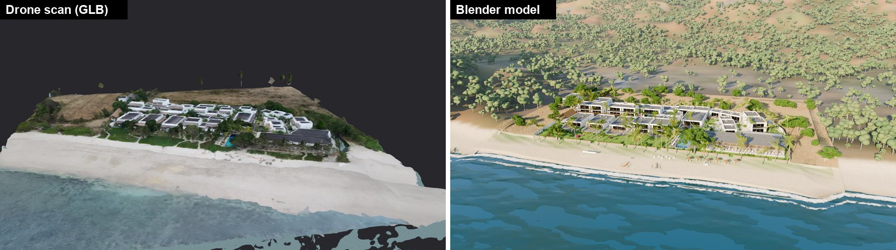
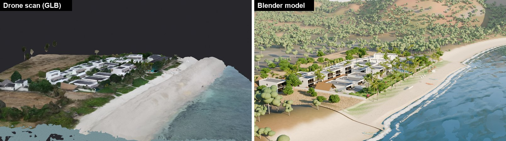
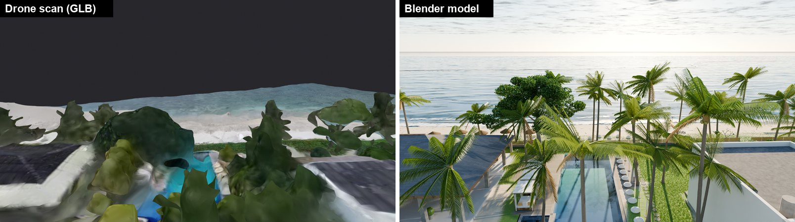
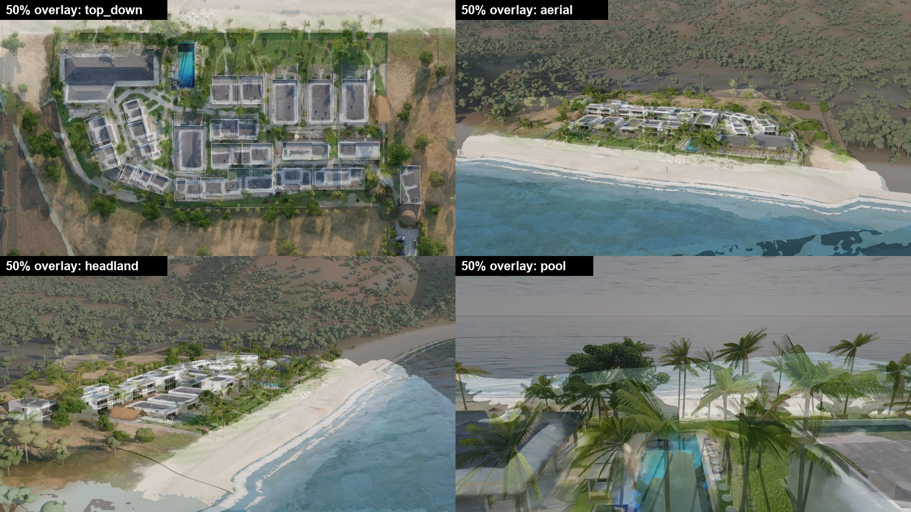
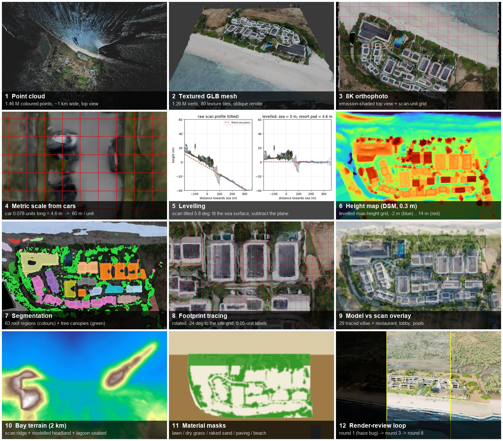
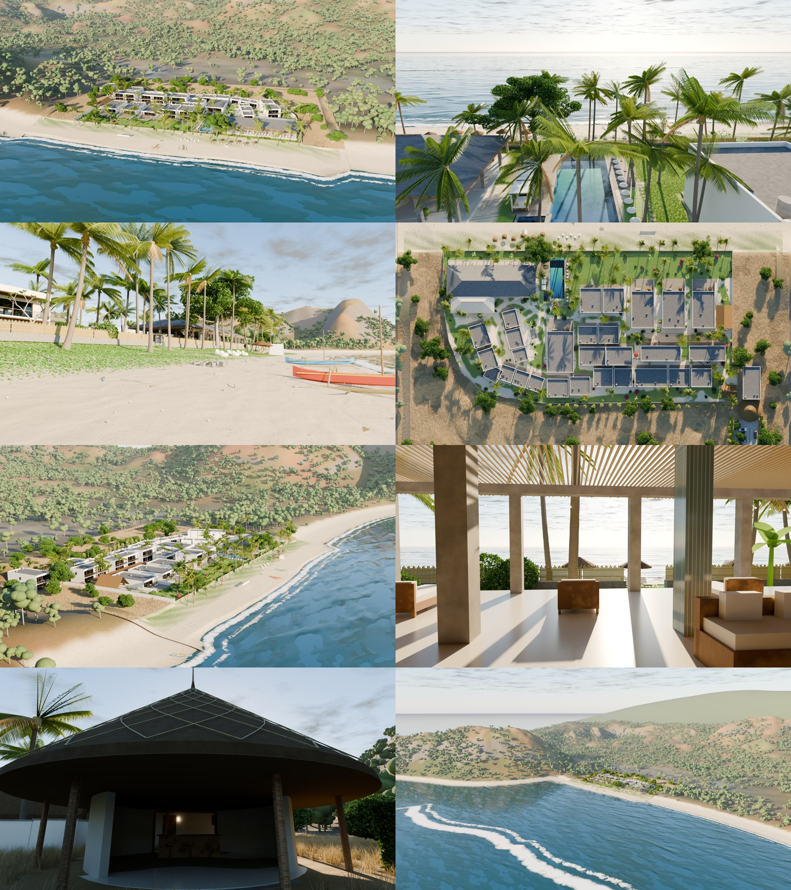

# scan-to-blender

A Claude Code **skill** that turns a 3D scan of a real place into a detailed, layered, editable Blender
scene. It accepts a Gaussian splat, a point cloud or a textured GLB/OBJ mesh. The skill researches the
place on the web for everything the scan can't see.

<p align="center">
  <a href="#get-a-scan-first"></a>
</p>

<p align="center">
  
</p>

*Example: a beach resort in Lombok, rebuilt from a drone scan (point cloud + GLB) plus web research.
Left of the yellow line is the Blender model; right of it is the original scan, seen from the same camera.*

## Scan vs. Blender model

The finished scene keeps the scan as an aligned, hidden reference layer. Every comparison below renders
the scan and the model from **the same Blender camera**, with no manual lining-up.





**Alignment check.** These are 50 % blends of scan and model. The villa outlines, restaurant roof, pool,
beach line and shoreline coincide in every view. One known difference: the restaurant's back wing is
slightly longer in the scan than in the model.



The pool view shows why research matters. From low angles the scan is a blob of melted palms, so the
pool deck, cabanas, bean bags and palm species were rebuilt from the resort's own photos.

## How it works, step by step



| # | Step | What happens |
|---|---|---|
| 1–2 | **Read the scan** | The point cloud (1.46 M pts) gives the ~1 km surroundings. The textured GLB gives the site. They share one coordinate frame. |
| 3 | **Orthophoto** | An 8K emission-shaded top view of the mesh, with a JSON that maps pixels to world coordinates. |
| 4 | **Metric scale** | Measured from parked cars (0.078 units = 4.6 m), giving 60 m per unit. Cross-checked against pool and villa sizes from research. |
| 5 | **Levelling** | The scan was tilted 5.8°. An IRLS plane fit on the sea surface removes it. The compound plane comes out parallel, at 4.6 m above sea level. |
| 6 | **Height map** | A 0.3 m DSM in the levelled site frame. A percentile filter gives the bare ground; relative height gives storeys. |
| 7 | **Segmentation** | Elevated, non-green regions are roofs (63 regions); elevated green regions are tree canopies (positions feed the vegetation). |
| 8 | **Tracing** | The ortho is rotated to the site grid (dominant angle −24°) and footprints are traced on labelled grid crops. Segmentation merges terraced blocks, so it serves only as a hint. |
| 9 | **Overlay** | Traced layout on the scan, approved before the full build. |
| 10 | **Terrain** | The levelled scan near the site and the scanned eastern ridge, plus a modelled steep headland (a scan blind spot), a curved bay and a lagoon seabed with a reef drop-off. |
| 11 | **Material masks** | Lawn, dry grass, raked sand, paving and beach, from ortho colour plus the layout. They drive both shaders and Geometry Nodes scattering. |
| 12 | **Render-review loop** | Eight rounds of low-res renders, contact sheet, fix. Round 1 came out black because of world-volume haze plus a sun lamp; this is now in `references/pitfalls.md`. |

## Final renders



## What it does

1. **Reads the scan:** format detection (3DGS / point cloud / mesh), Z-up conversion, 8K orthophoto,
   oblique views.
2. **Recovers real scale and level:** scale from cars, doors and parking bays; tilt removed by fitting the
   sea, lake or ground plane.
3. **Builds height maps:** DSM, bare ground and relative heights give footprints, storey counts and tree
   positions in a metric site frame.
4. **Researches the place** in a parallel subagent: official site, booking sites, OpenStreetMap, blogs. It
   downloads reference photos and fills the gaps the scan can't cover (façades, materials, interiors,
   plant species, blind-spot landscape).
5. **Plans the site:** footprints traced on labelled grid crops into a single editable `layout.py`, with
   an overlay on the scan for approval.
6. **Builds procedurally** with headless Blender Python: terrain, water, buildings with real openings,
   roofs, pools, furniture, procedural plants scattered with Geometry Nodes, distant landscape, sky and
   cameras. It uses a clean collection hierarchy and keeps the aligned scan as an excluded reference layer.
7. **Verifies in a loop:** low-res renders → contact sheet → fix → repeat. It then sets viewport-light
   mode and renders the finals.

## Get a scan first

The skill starts from a 3D scan of a place. A drone or phone video is enough: upload it to one of the apps
below and it returns a Gaussian splat and/or a textured mesh.

### 1. Capture

- Move **slowly** in wide orbits around the place, with plenty of overlap between frames. The example resort
  is a single drone flight of about 4 minutes.
- Cover it from more than one height and angle, and avoid fast turns (motion blur ruins a scan).
- Stay at a distance from people and private spaces, and follow your local drone rules. If the app can remove
  people from the scan, turn it on (Luma calls it "Remove People").
- No drone? A phone video works the same way: walk slowly around the place and film it.

### 2. Turn the video into a scan

| Tool | Runs on | Input | Exports | Cost |
|---|---|---|---|---|
| [Luma 3D Capture](https://apps.apple.com/app/luma-3d-capture/id1615849914) ([lumalabs.ai](https://lumalabs.ai/)) | iPhone app and web | Video upload, or capture in the app | Gaussian splat and textured mesh (the example used a GLB mesh and a splat PLY) | Free app |
| [Polycam](https://poly.cam/) | iOS and web (Android makes meshes only) | Photos or video | PLY (choose **Splat PLY**; a plain PLY is a point cloud) | Free plan has no splats |
| [Scaniverse](https://scaniverse.com/) | iOS, Android and web | Phone capture | PLY, SPZ | Free, unlimited on-device processing; paid plans add cloud processing |
| [KIRI Engine](https://www.kiriengine.app/) | iOS, Android and web | Photos or video | Check the app's export options | Free tier |
| [Postshot](https://www.jawset.com/) | Windows, NVIDIA GPU | Your own photos or video, trained on your PC | PLY | Free plan is non-commercial and cannot export splats |
| [nerfstudio (Splatfacto)](https://docs.nerf.studio/) | Linux (Windows less tested), CUDA GPU | Photos or video | PLY | Free, open source |

Luma's flagship product is now Dream Machine (video generation), so its capture app is updated less often. If
its export menu looks different from what is described here, use one of the others: every splat trainer can
export a `.ply`, which the skill reads.

### 3. Export and hand it over

- Export the **Gaussian splat as `.ply`**. Some apps (Luma) download a ZIP: unzip it and use the `.ply` inside.
- If the app also offers a **textured mesh** (Luma: GLB), export that too. In the example, the point cloud
  gave the surroundings and the textured GLB gave the site; the skill reads either one on its own.
- Optional: crop stray splats first in a splat editor such as [SuperSplat](https://superspl.at/editor).
- Then follow [Use](#use): give Claude the file path(s), the place name and its location.

Tool details and prices change. Last checked 28 Oct 2026.

## Install

```bash
# personal skill (all projects)
git clone https://github.com/ahmakader/scan-to-blender ~/.claude/skills/scan-to-blender
# or per project
git clone https://github.com/ahmakader/scan-to-blender .claude/skills/scan-to-blender
pip install -r ~/.claude/skills/scan-to-blender/requirements.txt
```

You need Blender 4.2+ (tested on 5.1) and Python 3.10+ with the packages in `requirements.txt`. A GPU is
recommended for Cycles.

## Use

In Claude Code:

```
/scan-to-blender
Scan: D:/scans/villa.ply and D:/scans/villa.glb
Place: Villa Xyz, Uluwatu, Bali. Faces the ocean to the west, 6 bedrooms.
Blender: C:/Program Files/Blender Foundation/Blender 5.1/blender.exe
Output: D:/projects/villa-xyz
```

Or just describe it ("model this scan of … in Blender with all the details"). The skill triggers from its
description.

## Contents

```
SKILL.md                      workflow Claude follows (phases, hierarchy, verification)
references/pitfalls.md        hard-won gotchas: linear colours, haze, ocean tiles, shadow-clear water...
references/research-checklist.md   brief for the research subagent
references/detail-checklist.md     what "high detail" means, element by element
scripts/scan_inspect.py       PLY / 3DGS / GLB / OBJ / LAS / XYZ -> Z-up coloured points + summary
scripts/render_views.py       Blender: emission orthophoto (+ pixel<->world json) and obliques
scripts/level_and_dsm.py      fit plane, dominant angle, site frame, DSM/ground/footprints/trees
scripts/grid_crop.py          labelled metric grid crops for tracing and measuring, with overlays
scripts/contact_sheet.py      preview grid of renders
scripts/compare_scan_model.py render the scan from the model's cameras + side-by-sides, overlays, wipe GIFs
scripts/render_cameras.py     Blender: render all/some cameras on GPU
scripts/viewport_light.py     Blender: make the .blend light to navigate (renders unchanged)
templates/build/              layout + build templates and libraries (mesh builder, materials,
                              architecture, vegetation), copied into each project and adapted
```

### Script quick reference

```bash
python scripts/scan_inspect.py scan.ply scan.glb --out work
blender -b --factory-startup -P scripts/render_views.py -- scan.glb work/views 8192
python scripts/level_and_dsm.py fit work/points_scan.npy --color water --out work/plane.json
python scripts/level_and_dsm.py angle work/views/ortho.png work/views/ortho.json
python scripts/level_and_dsm.py frame --plane work/plane.json --scale 60 --origin -0.35 -0.15 --angle -24 --out work/frame.json
python scripts/level_and_dsm.py dsm work/points_scan_glb.npy --frame work/frame.json --extent -110 110 -90 95 --out work/dsm
python scripts/grid_crop.py work/views/ortho.png work/views/ortho.json --frame work/frame.json --u 0 60 --v -20 40 --grid 2 --out crop.png
```

## Limitations

- Façades, interiors and fine details are **reconstructed from photos**, not measured. The skill labels what
  is estimated.
- Scale comes from known objects unless the scan is georeferenced; expect ±3–5 %.
- Gaussian splats are converted to points (DC colour, opacity-filtered). View-dependent colour is lost.
- The bundled `lib_arch.py` building types come from a tropical resort. Expect to add types for other
  architecture.

## License

MIT
